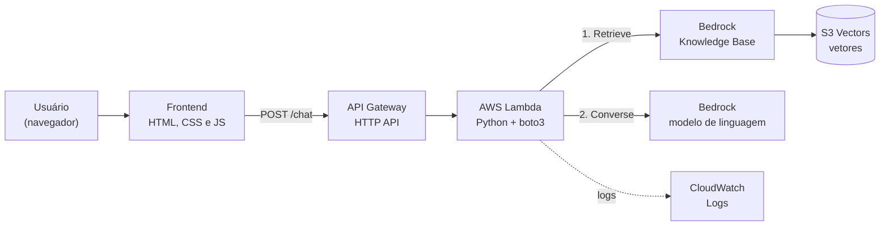
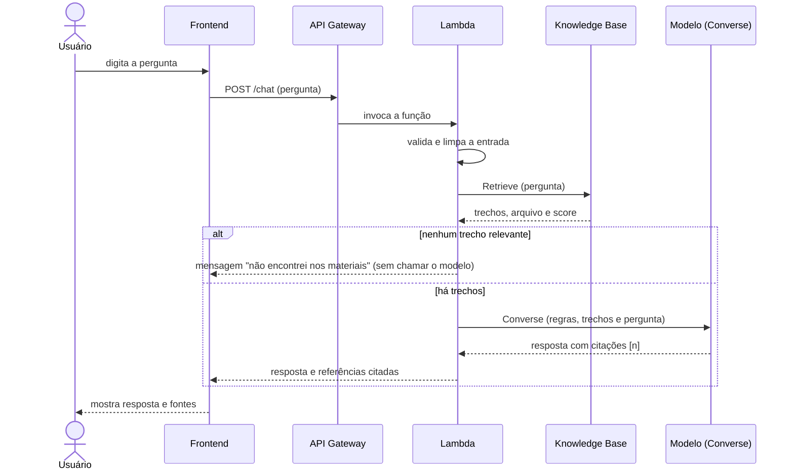
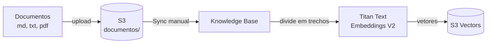

# Arquitetura

## Visão geral

## Fluxo de uma pergunta

## Fluxo de ingestão dos documentos

## Serviços AWS utilizados

Região: `us-east-1`.

| Serviço | Papel no projeto | Configuração principal |
|---|---|---|
| **API Gateway (HTTP API)** | Expõe o backend por uma URL HTTP | Rota `POST /chat`, integração Lambda (payload 2.0), CORS no próprio gateway, limite de requisições por stage |
| **Lambda** | Valida a entrada, recupera trechos, monta o prompt, chama o modelo e trata erros | Python, timeout 30 s, 256 MB, variáveis `MODEL_ID`, `KB_ID`, `N_RESULTADOS`, `SCORE_MINIMO` |
| **Amazon Bedrock (Converse)** | Gera a resposta a partir dos trechos recuperados | Modelo definido em `MODEL_ID`; `temperature` 0.2 e `maxTokens` 700 |
| **Bedrock Knowledge Base** | Indexa os documentos e recupera trechos por similaridade semântica | Fonte S3 (`documentos/`), chunking e parsing padrão |
| **Titan Text Embeddings V2** | Transforma trechos e perguntas em vetores | 1024 dimensões |
| **S3 (documentos)** | Guarda os documentos de estudo | Bucket privado, acesso público bloqueado, SSE-S3, versionamento, HTTPS obrigatório |
| **S3 Vectors** | Armazena os vetores da Knowledge Base | Criado pelo "Quick create" do console |
| **IAM** | Controla o acesso entre os serviços | Role da Lambda com mínimo privilégio; role de serviço da KB criada pelo console ([seguranca.md](seguranca.md)) |
| **CloudWatch Logs** | Registra erros e metadados das requisições | Retenção limitada; a pergunta do usuário não é registrada |

## Decisões de projeto

| Decisão | Alternativa descartada | Motivo |
|---|---|---|
| **S3 Vectors** como armazenamento vetorial | OpenSearch Serverless | O OpenSearch Serverless tem custo mínimo mensal alto, mesmo sem uso; o S3 Vectors cobra por uso |
| **`Retrieve` + `Converse`** na Lambda | `RetrieveAndGenerate` | Dá controle sobre o prompt, o filtro por score, as referências devolvidas e o caso "sem evidência" |
| Sem trechos recuperados, **não chamar o modelo** | Sempre chamar o modelo | Resposta honesta garantida e mais barata |
| Retornar só as referências **citadas** pelo modelo | Retornar todos os trechos recuperados | Evita mostrar fontes que não sustentam a resposta |
| **HTTP API** | REST API | Mais simples e mais barata; não precisamos dos recursos extras da REST API |
| **CORS no API Gateway**, não na Lambda | Cabeçalhos CORS no código | Um único lugar de configuração; o gateway responde ao pré-voo sozinho |
| Erros **genéricos** ao usuário, detalhes no log, `id_requisicao` para rastreio | Repassar a mensagem da AWS | Não expor ARN, IDs e nomes de recursos |
| A Lambda **não** tem permissão de S3 | Lambda lendo documentos | Quem lê o S3 é a Knowledge Base, com a própria role |
| **Escape de `<` e `>`** em pergunta e trechos no prompt | Inserir o texto cru | Impede fechar as tags do prompt e injetar instruções |
| Frontend em **HTML, CSS e JS puros** | Framework web | O chat é uma única tela; um framework não traria ganho |
| Criação manual no console | Infraestrutura como código | Escopo e prazo do projeto; ver [limitacoes.md](limitacoes.md) |

## Custos

Todos os componentes são cobrados por uso (requisições da API, execuções da Lambda, tokens do Bedrock, armazenamento e consultas no S3 e no S3 Vectors). Não há componente com custo fixo mensal relevante, e é recomendável manter um alerta de orçamento (AWS Budgets) ativo.